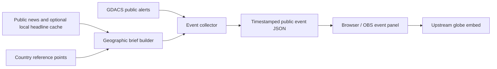

# God's Eye View: source-linked global event integration

Deploy a globe on a small VM and connect it to public natural-hazard alerts and technology-related news briefs, with explicit sources, timestamps and qualified geography.

## Recorded deployment

The original October 21–22, 2026 build used an Ubuntu Server 24.04 VM with 4 vCPUs, 6 GiB RAM and a 32 GiB disk. It ran the upstream [God's Eye View](https://github.com/bilawalsidhu/gods-eye-view) app and added an OBS/browser panel. No GPU was passed through: rendering occurred in the desktop browser. Later OBS preview checks rendered the regional globe and event context; an HTTP response alone was not considered proof of WebGL operation.

This directory publishes the integration code and reproducible inputs. It does not vendor the upstream globe application, personal browser sessions, provider keys, live feed caches or the unrelated sports/news dashboard projects.

## What the integration does

- Filters recent GDACS cyclone, flood, wildfire, earthquake and drought alerts with reported locations and severity.
- Canonicalizes approved GDACS links to HTTPS and rejects unexpected hosts or credential-bearing URLs.
- Builds rule-based briefs only when a relevant headline explicitly names a supported place. It does not infer a company's affected location from its headquarters.
- Includes the original source, publication/bulletin time, geographic basis, potential relevance and a follow-up watch item.
- Uses smooth globe moves, renders report text before map readiness, and scrolls long affected-region lists instead of crowding the panel.
- Accepts parent-frame control messages only from the configured origin; globe replies must come from the expected child frame and origin.

See [setup and operation](global-events/README.md), [knowledge checks](KNOWLEDGE_CHECK.md) and [data attribution](NOTICE.md).

## Validation and unfinished work

Historical deployment checks returned populated alert/context JSON, verified original links, exercised the location/filtering rules and rendered the OBS preview without navigating the user's personal browser. The included Python/JavaScript regression checks are rerun for publication. Public environment-variable packaging is not a fresh end-to-end VM deployment.

The source VM used private inbound access restrictions and persistent startup. Reproduce those controls for your own environment. Provider availability, WebGL support, upstream changes and optional API-key features still require environment-specific checks. Dedicated DHCP reservation and independent restore testing are separate operational follow-ups.

This is a public information display, not a weather instrument, confirmed outage map, battlefield tracking system, investment recommendation or trading signal. Country/city reference points are not precise incident footprints. Nearby mapped data-center points do not prove impact or absence of unmapped infrastructure.

Planning, integration code, tests and documentation received material AI assistance. Operator teaching and recovery drills are separate learning goals.
