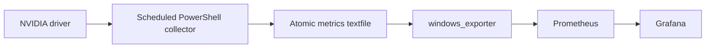

# Windows GPU worker monitoring

Collect Windows and NVIDIA GPU telemetry in Prometheus and compare workstations in Grafana, without changing GPU power settings or running an AI workload.

## Implemented result

The October 21, 2026 deployment used windows_exporter 0.31.9 for CPU, RAM, disk, network and uptime, plus a scheduled `nvidia-smi` collector for temperature, utilization, power and VRAM. Two Windows machines were verified: one RTX 3070 with 8 GiB VRAM and one RTX 4090 with approximately 24 GiB. Hardware identification came from the driver rather than the initial inventory description.



Public addresses below are documentation examples. Configure a private monitoring path and restrict the exporter firewall rule to the actual Prometheus server.

## Reproduce

1. Install the official [windows_exporter release](https://github.com/prometheus-community/windows_exporter/releases/tag/v0.31.9). Verify its installer checksum against that release's metadata. Enable the textfile collector with a dedicated directory, alongside the Windows collectors you need.
2. Save `collect-gpu-metrics.ps1` locally. Run it with the same textfile directory configured for the exporter:

   ```powershell
   powershell.exe -NoProfile -File .\collect-gpu-metrics.ps1 -MetricsDirectory C:\ProgramData\THM\metrics
   ```

3. Configure a Windows Scheduled Task to run once a minute under an account that can query the NVIDIA driver and write that directory. Use a 20-second execution limit, ignore overlapping starts, and leave **Wake the computer to run this task** disabled.
4. Adapt `prometheus.example.yml`, check it with `promtool check config`, and reload Prometheus using your existing procedure. The example assumes the exporter's normal port 9182; match the actual deployment.
5. Add the queries below to Grafana with `instance` and `gpu` selectors.

The task writes a temporary file in the destination directory and replaces the completed metrics file. On a GPU-query failure it emits a failure flag instead of retaining old GPU readings. It never writes the driver command's raw error text into metrics.

## Useful queries

```promql
thm_gpu_temperature_celsius
thm_gpu_utilization_percent
thm_gpu_power_watts
thm_gpu_memory_used_bytes / thm_gpu_memory_total_bytes * 100
thm_gpu_collect_success == 0
time() - thm_gpu_collect_timestamp_seconds > 120
```

Check both collection success **and** timestamp age. The presence of a file alone does not establish fresh telemetry. An unavailable worker may be asleep or disconnected; monitoring does not distinguish those causes by itself.

## Validation and limits

Historical deployment checks confirmed exporter scrapes, GPU metric values, total VRAM, scheduled-task execution and a comparison dashboard. The source collector was deployed on both workstations. This public copy consolidates their directory-specific scripts into one parameterized helper; that packaging has not been rerun on Windows as part of publication. It is not a sleep controller, gaming-priority scheduler, power limiter, alert-delivery system or AI runtime.

No process/service collectors were enabled in the original deployment. Consider the privacy implications before adding them.

## Recovery practice

Pause only the GPU task and verify that the timestamp-age query detects stale collection. Resume it and confirm recovery. This is a proposed drill, not a claim of a completed failure exercise. To remove the project, disable its task and remove its scrape target before removing the exporter. Preserve pre-existing exporter tasks and targets.

## Required reading

| Source | Read to understand |
|---|---|
| [Windows exporter](https://github.com/prometheus-community/windows_exporter) | Collector selection, textfile collection and endpoint configuration |
| [NVIDIA SMI](https://docs.nvidia.com/deploy/nvidia-smi/) | Query fields, units and unsupported readings |
| [Prometheus configuration](https://prometheus.io/docs/prometheus/latest/configuration/configuration/) | Targets, labels and scrape intervals |

See [knowledge checks](KNOWLEDGE_CHECK.md). Build scripts and documentation received material AI assistance; independent operator explanation and recovery practice are separate learning goals.
