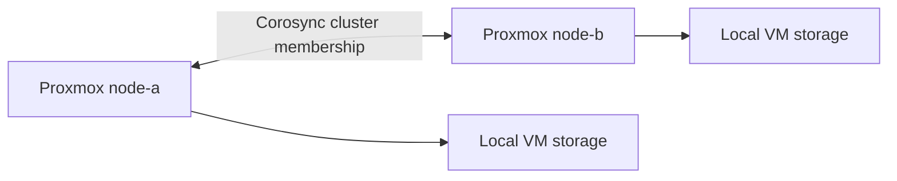

# Expand a Proxmox homelab to two nodes

Add compute capacity while keeping the difference between cluster membership and high availability explicit.

## Implemented result

The recorded deployment joined a second Proxmox VE host to an existing host. Both were online and the cluster reported quorum. The recorded total was 40 CPU threads and approximately 121 GiB host RAM; these are historical inventory values, not a new capacity measurement at publication.

| Example node | CPU threads | RAM | Role |
|---|---:|---:|---|
| node-a | 24 | 58.5 GiB | Existing guests and shared infrastructure |
| node-b | 16 | 62.4 GiB | Additional lab capacity |



## Change sequence

1. Back up existing guests and record host/network/storage configuration. Confirm restore access before changing cluster membership.
2. Install Proxmox VE on the new host using a verified installation target. The new-host installation in this build replaced its previous OS; disk selection is a destructive step requiring deliberate approval.
3. Set a stable hostname, management addressing and working time synchronization. Ensure the new host's hostname is unique and both hosts can resolve/reach the addresses used for cluster communication.
4. Align Proxmox versions before joining. Review the upstream cluster prerequisites, especially restrictions on joining a node that already contains guests.
5. Join the new node through the supported Proxmox cluster workflow. Do not copy live configuration files between hosts as a substitute for joining.
6. Inspect membership, quorum, transport health, storage visibility and running guests.

Real addresses, hostnames and join material are intentionally omitted. Use the actual environment's approved networking plan; no join token belongs in Git.

## Read-only validation

Run on an authorized Proxmox host:

```bash
pvecm status
pvesh get /cluster/resources --type node
pvesh get /cluster/resources --type storage
pvesm status
```

Expected: both intended nodes are present, cluster quorum is established while both are online, and expected storage is visible. Compare actual guest availability against the pre-change inventory. Historical build notes record successful membership, quorum and storage checks; a fresh join was not performed for publication.

## Limits and unfinished work

This is a working **two-node cluster, not a completed HA design**. Both votes are needed in the basic configuration. Losing a node can affect quorum and configuration operations even when a guest on the surviving node continues running. Local VM disks do not become shared merely because their hosts form a cluster.

A third vote via an independently placed QDevice remains a follow-up. Do not put the only quorum helper inside the same failure domain and then claim independent availability. Automated guest failover, shared storage and recovery-time guarantees were not established by this task.

## Recovery practice

Plan any node-loss exercise off-stream and with backups and console access available. Record which guests and management actions remain available, then restore normal membership and confirm quorum. This is a proposed exercise, not completed HA testing.

Removing a joined node is a separate cluster operation. Preserve guest disks/configuration and follow the upstream node-removal procedure; do not treat node removal as uninstalling an application.

## Required reading

- [Proxmox cluster manager](https://pve.proxmox.com/pve-docs/chapter-pvecm.html): membership, quorum, joining/removal, QDevice placement.
- [Proxmox administration guide](https://pve.proxmox.com/pve-docs/pve-admin-guide.html): networking, storage and backup prerequisites.

See [knowledge checks](KNOWLEDGE_CHECK.md). Planning and documentation received material AI assistance; reproducibility and operator mastery are separate validation goals.
