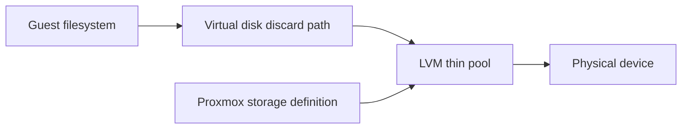

# Recover unused Proxmox storage capacity

Make an existing thin pool available for VM disks without formatting it, then distinguish storage registration from filesystem allocation and physical free space.

## Implemented result

The build registered an existing, otherwise-unused approximately 920 GiB LVM-thin pool and confirmed reclaimed allocation after guest cleanup and TRIM. Recorded total thin capacity across the lab was approximately 2.45 TiB, with about 2.29 TiB free at that point. Those values predate subsequent lab deployments and are not current capacity claims.



## Change sequence

1. Inventory physical devices, volume groups, thin pools, their allocation, and existing Proxmox storage definitions. Save configuration and guest backups.
2. Verify the intended pool already exists and is not already registered under another storage ID. Inspect pool metadata usage as well as data usage.
3. Add a Proxmox storage definition for that existing LVM-thin pool through the supported UI/API workflow. Select its actual volume group and thin-pool name, enable only intended content types, and restrict it to the host that owns it.
4. Confirm the new storage appears with the expected capacity. **This task did not require formatting a disk or creating a replacement filesystem.**
5. For compatible guest disks, enable the approved discard path. Confirm the guest filesystem and controller support it before using TRIM.
6. After guest cleanup, compare guest free space and host thin-pool allocation. Record both; they measure different things.

Public examples omit real device identifiers and storage configuration. Do not run a formatting, `pvcreate`, or `lvremove` command to reproduce storage *registration*.

## Read-only inspection

On the hypervisor:

```bash
pvesm status
lvs -o lv_name,lv_size,data_percent,metadata_percent
```

In a Linux guest:

```bash
lsblk -D
systemctl status fstrim.timer
```

Where approved and supported, scheduled TRIM can be enabled and a manual trim run:

```bash
sudo systemctl enable --now fstrim.timer
sudo fstrim -av
```

The final two commands change operation; inspect the target environment and arrange an appropriate maintenance window first. TRIM does not remove allocated live files, but deleted blocks should not be treated as recoverable backups.

## Validation and limits

Recorded evidence confirmed the existing pool, successful registration, expected storage capacity and lower thin allocation on the optimized VM disks. No destructive reformat or new production benchmark was performed for publication.

LVM thin provisioning allows virtual allocation to exceed physical headroom. Monitor data and metadata percentages and leave room for growth. Guest `df` results are not a substitute for host pool monitoring.

The additional pool remains **local storage**. It is not replication, shared storage or automatic failover. Moving a VM that depends on it requires moving the disk or designing an appropriate storage/replication arrangement.

## Recovery practice

Practice identifying an unavailable storage definition in a disposable environment while preserving the underlying volumes. A configuration backup can restore registration metadata; it cannot recreate deleted or overwritten guest data. Do not remove a storage definition until its dependent disks and guests have been accounted for.

## Required reading

- [Proxmox storage manager](https://pve.proxmox.com/pve-docs/chapter-pvesm.html): storage IDs, content types, host restrictions and shared/local semantics.
- [LVM-thin storage](https://pve.proxmox.com/wiki/Storage:_LVM_Thin): pool behavior and limitations.
- [fstrim manual](https://man7.org/linux/man-pages/man8/fstrim.8.html): discard behavior and supported filesystems.

See [knowledge checks](KNOWLEDGE_CHECK.md). Investigation and documentation received material AI assistance; failure drills and independent operator explanation remain separate practice goals.
